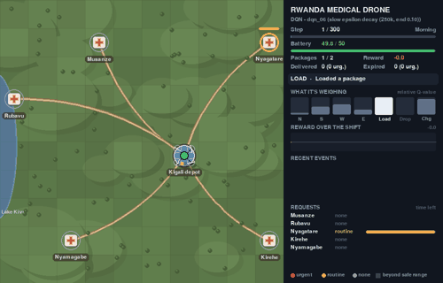
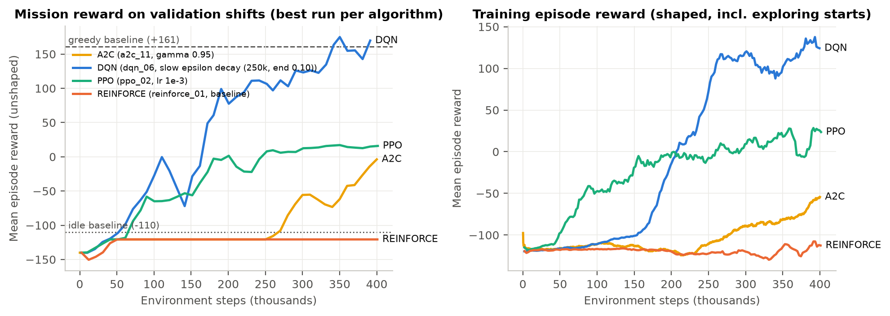
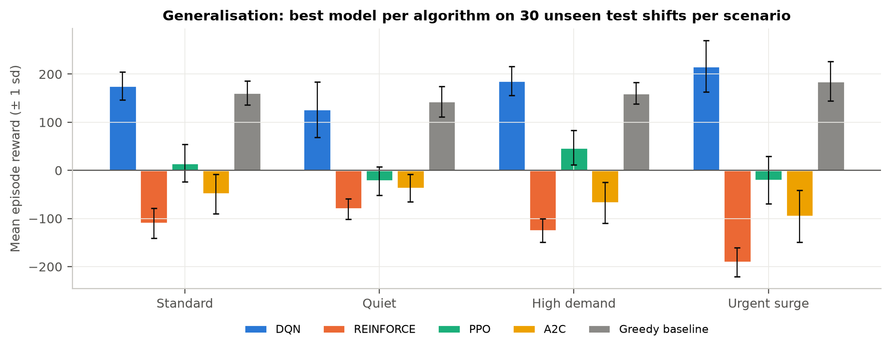

# Rwanda Medical Drone Delivery: Mission-Based Reinforcement Learning

**GCGO: Healthcare.** A drone based at a depot in Kigali serves five rural health centres (Musanze, Rubavu, Nyagatare, Kirehe, Nyamagabe). Requests for blood and medicine appear over the shift, urgent ones expire fast, and the battery only lasts about three round trips. The agent learns which request to serve next, when to go home to recharge, and never to strand the drone. DQN, REINFORCE, PPO and A2C are trained with **TorchRL** on the same environment and compared.



## Quick start

```bash
uv sync
uv run main.py                 # best trained agent, 2D pygame view, step-by-step terminal log
uv run main.py --view 3d       # three.js race: best DQN vs REINFORCE vs PPO vs A2C (opens the browser)
uv run play.py                 # same as main.py
```

A rendered tour of the results (environment, sweeps, figures, the best agent flying a shift, the policy API) is in [`notebooks/showcase.ipynb`](notebooks/showcase.ipynb); rebuild it with `uv run python notebooks/build_showcase.py`.

Useful flags: `--algo {dqn,reinforce,ppo,a2c}`, `--scenario {standard,quiet,high_demand,urgent_surge}`, `--episodes N`, `--fps N`, `--view none`.

## Environment

| | |
|---|---|
| **Map** | 10×10 grid of Rwanda; Kigali depot at (6,5); five clinics placed where their districts sit |
| **Actions (7)** | fly north / south / west / east, load a package (depot), deliver (clinic with an open request), recharge (depot) |
| **Observation (32, all in [-1, 1])** | drone x, y, battery, packages, shift time left; per clinic: open request, urgent, waiting time ÷ deadline, dx, dy; depot dx, dy (`environment/custom_env.py:OBS_FIELDS`) |
| **Start** | drone at the depot, full battery (50), no packages, 1–2 open requests |
| **Dynamics** | any airborne step costs 1 battery (flying and hovering alike), landed actions 0.2, recharge +20; capacity 2; each free clinic raises a request with probability 4%/step, 35% urgent; urgent deadline 40 steps, routine 120 |
| **Rewards** | routine delivery +5; urgent +10 plus up to +10 for speed; expired urgent −10, routine −3; waiting −0.1 (urgent) / −0.02 (routine) per step; invalid action −0.5; crash −100 plus every open request counted as expired |
| **Terminal** | battery empty away from the depot (crash); truncated at 300 steps (end of shift) |

All four algorithms train in the same environment with three standard aids, and every reported number uses the true mission reward from the normal start state:

- **Potential-based shaping** `γΦ(s′) − Φ(s)`, Φ = −k × steps to the next delivery (k = 1), which provably leaves the optimal policy unchanged (Ng et al., 1999).
- **Feasible-action mask** computed from the observation (no loading mid-air, no delivering without a package or request).
- **Exploring starts**: half of the training shifts begin at a random cell, battery and load (always with enough charge to reach home).

Without them, plain PPO never makes a delivery in 400k steps and converges to crashing or idling at the depot.

Reference policies (30 test shifts, `uv run python -m environment.evaluation`): hand-written greedy +160.8, idle at the depot −110.2, deliberate crash −136.0, random −147.9.

## Training and analysis

```bash
uv run python -m training.dqn_training --workers 2                        # 13-run DQN sweep
uv run python -m training.pg_training --algo all --workers 2              # 12-13 run sweeps for REINFORCE, PPO, A2C
uv run python -m training.dqn_training --best --seeds 1 2 --workers 2     # best DQN config on two more seeds
uv run python -m training.pg_training --algo all --best --seeds 1 2       # same for each policy-gradient method
uv run python -m training.analysis                                        # figures -> assets/, tables -> assets/tables/
```

Sweeps are resumable: re-running a command skips runs that already have results (`--force` retrains). Every run trains for the same 400k environment steps, picks nothing on test data (models are selected on 20 validation shifts and reported on 30 unseen test shifts per scenario), and writes `logs/<algo>/<run>.csv` (learning curve), `logs/<algo>/<run>.json` (config and evaluation) and `models/{dqn,pg}/<run>.pt`.

## Results

Best configuration per algorithm, selected on 20 validation shifts and scored on 30 unseen test shifts (standard demand). The last column retrains that configuration with seeds 0, 1 and 2.

| Algorithm | Best configuration | Test reward | Deliveries / shift | Crash rate | Mean over 3 seeds |
|---|---|---|---|---|---|
| DQN | slow ε-decay (250k steps, end 0.10) | **+175.6** ± 29.0 | 21.2 | 0.00 | +165.0 (sd 14.2) |
| PPO | learning rate 1e-3 | +15.2 ± 39.1 | 10.2 | 0.00 | +14.4 (sd 1.4) |
| A2C | γ = 0.95 | −48.6 ± 41.0 | 4.1 | 0.03 | −83.2 (sd 36.2) |
| REINFORCE | baseline (most runs tie) | −110.2 ± 31.1 | 0.0 | 0.00 | −110.2 (sd 0.0) |
| Greedy heuristic | hand-written | +160.8 ± 24.7 | 20.1 | 0.00 | – |

Sweep runs that deliver at least one package per shift: DQN 13/13, PPO 3/13, A2C 1/12, REINFORCE 0/12. Full tables are in `assets/tables/`, every run in `logs/results.csv`.




## Integration

`uv run main.py --view 3d` starts a FastAPI server (`environment/server.py`); interactive docs at `/docs`.

| Endpoint | Purpose |
|---|---|
| `GET /api/meta` | map layout, action names, observation fields, loaded agents |
| `POST /api/act` | `{"observation": [32 floats], "agent": "PPO"}` → chosen action and its scores |
| `WS /ws` | one JSON frame per step; send `{"type": "emergency", "clinic": i}`, `pause`, `reset`, `speed` |

Checkpoints are plain PyTorch state dicts with the observation field names and action list stored alongside, so any frontend or service can load them.

## Layout

```
environment/  custom_env.py (Gymnasium env), rendering.py (pygame), server.py + web/ (FastAPI + three.js), evaluation.py
training/     common.py, dqn_training.py, pg_training.py, analysis.py
models/       dqn/, pg/          logs/  per-run curves and results        assets/  figures, tables, GIF
notebooks/    showcase.ipynb (executed, renders on GitHub) and the script that builds it
tests/        environment, reward-design and action-mask tests (uv run pytest)
```
